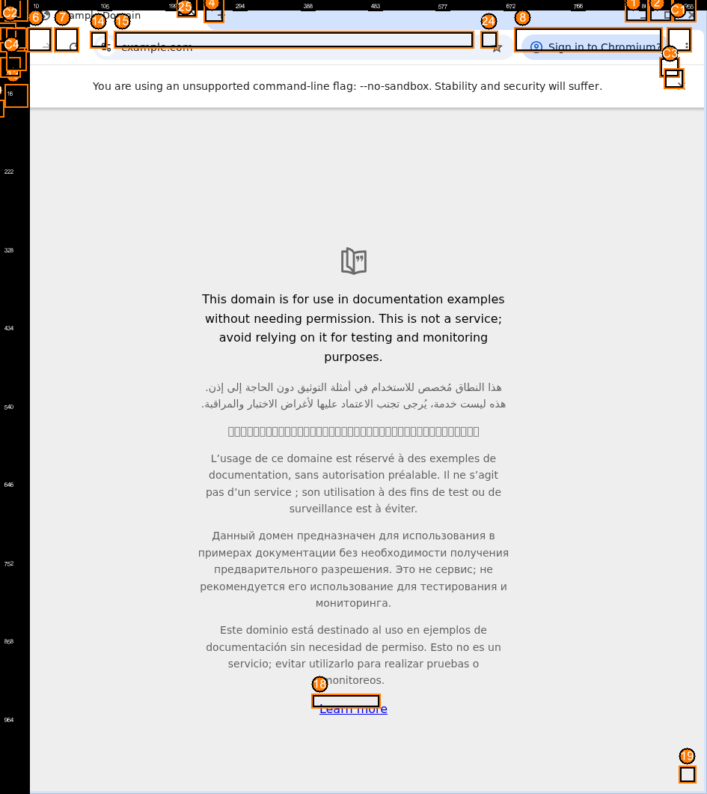
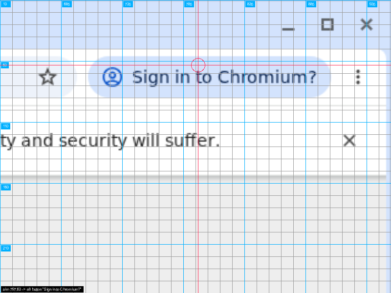

# v2 redesign: the model-facing contract

Status: design accepted (2026-10-16); implementation in progress (M1/M2). Scope: Linux/X11. Baseline: upstream `main` at `67e9e2f` (post-#103).

## Goals

- A model-first contract: the agent receives a compact JSON snapshot and at most one image per observation.
- Semantic first, pixels last — but pixels are verifiable, never a blind guess.
- Every claim measured on the models we actually run, starting with DeepSeek V4.1 Flash (see [baseline](#baseline-deepseek-v41-flash)).

## Tool surface (draft)

| tool | purpose |
|------|---------|
| `observe` | current snapshot: window meta + elements + text; optional annotated screenshot |
| `act` | `steps[]` (`click` / `type` / `key` / `scroll` / `drag` / `wait` / `aim` / `commit`); pre-validated; returns the new snapshot plus a change report |
| `read` | full text of a truncated element or a text continuation |
| `zoom` | native-resolution crop of a region or element, with graticule |
| `wait` | condition on text / change / focus with timeout |
| `find` | element filter by role or text — keep only if a flat snapshot proves too large |

The browser tools (`launch_browser`, `navigate_browser`, `evaluate_browser`) stay as they are initially; their snapshots get converted to the same format in M2.

Rules:

- **No epochs.** `act` accepts only the latest state; a stale state returns the fresh snapshot instead of an error.
- **Validate before dispatch.** If any step in a batch is invalid, nothing is dispatched; the error names the step and the valid alternatives.
- **Always report outcomes.** Every act returns a compact change report (`changed`, `focused`, `appeared`, `removed`). `changed: false` is a signal, not a success.
- **Text-only models still work**, minus the visual modality. The extension reads the active model's input modalities (`ctx.model.input`, `"text" | "image"`), omits images, and adds a one-line advisory that a vision-capable model is strongly recommended for computer use, with the agent offering to switch.

## Snapshot (JSON)

```json
{
  "state": "s7",
  "window": { "app": "Chromium", "title": "Example Domain", "screen": [10, 10], "size": [945, 1060] },
  "elements": [
    { "id": 8, "role": "button", "name": "Sign in to Chromium?", "rect": [687, 36, 199, 34], "actions": ["press"] },
    { "id": 12, "role": "entry", "name": "Address and search bar", "value": "example.com", "rect": [146, 53, 512, 28], "focused": true }
  ],
  "clusters": [
    { "id": "C1", "at": [820, 48], "elements": [3, 4, 5] }
  ],
  "text": [
    "This domain is for use in documentation examples without needing permission. ...",
    "هذا النطاق مُخصص للاستخدام في أمثلة التوثيق ..."
  ],
  "truncated": { "text": false }
}
```

Rules:

- **Flat list, no tree, no containers.** Roles normalized to a small vocabulary; `panel`, `frame`, `document`, `static` are structure, not elements. In the prototype, this cut 240 AT-SPI nodes to 25 elements.
- **Clusters stay clickable.** Elements whose badges would overlap are grouped; the image shows one marker per cluster (`C1`, `C2`, …) and the listing carries the member ids (decision 2026-10-16: per-cluster listing).
- **Capture-relative.** Only nodes that intersect the captured image are listed; AT-SPI rects can extend outside it (window decorations, `y = -10` controls). Rectangles stay in screen coordinates; the image is a scaled view with a known origin.
- **Sanitized values.** No U+FFFC, no D-Bus paths, no duplicated statics; window title does not leak into body text.
- **Text in one reading-order block**, capped (~2 KB) with continuation through `read`.
- **IDs are local to one state.** Cross-state stable IDs are an M1 research item; until then the model always acts on the newest snapshot.

## Visual contract

### Overview rendering

- Window capture scaled to a canonical max edge (default **1536**; config `images: off | 1024 | 1536 | native`). Overlays are drawn **after** scaling so they stay crisp.
- Element outline: 4 px black under-stroke + 2 px orange. Badge: 18 px circle with a 14 px numeral, offset above-left of the target (inside the corner when there is no room). Clustered elements get one marker instead of colliding badges.
- Rulers: edge strips with **screen-coordinate** labels roughly every 10 % (minimum ~96 px at render scale), labels ≥ 10 px. **No fine grid on the overview** — after provider downscaling it aliases into mush; 10 px guides only belong in crops.



### Zoom

- `zoom {id | x,y,w,h}` returns a native-resolution crop, upscaled ×2–3 (output capped near 1500 px) with a fine graticule: 10 px minor lines, 50 px major lines, labels every 50 px in screen coordinates.
- Upscaling is the only way to move detail below the provider's encoder patch size; it is the magnifier the overview cannot be.



### Aim → verify → commit (pixel fallback)

- `act {steps:[{aim:{x,y}}]}` renders a preview: overview with crosshair **plus** a crop centered on the point, and reports the element under it. Nothing is dispatched. The result is an armed state.
- `act {steps:[{commit:true}]}` dispatches the click; a new `aim` replaces the pending point; any new `observe` expires it. Cap at two adjustments, then commit.
- **Preview is on by default.** It triggers when the point is not inside a confident element, when the element is smaller than ~40 px, or when nothing is under the point; large, well-known targets skip it. Disable with `aim_preview: false` in the config.
- Every coordinate click — previewed or not — reports the element under the point and whether anything changed. Failures become informative instead of silent.
- Anchor clicks cover the middle ground: `{click: {id, anchor: "center" | "left" | "right" | [fx, fy]}}` for sliders and drag tracks, where the position *within* an element matters but pixels should not.

## Baseline: DeepSeek V4.1 Flash

Method: 8 rendered cards (1536×864), one isolated blue target each (16–64 px), half with edge rulers; the model read each card once and reported the target center; truth was withheld until guesses were recorded. Scripts and the full table: [`benchmarks/visual-acuity`](../benchmarks/visual-acuity/README.md).

Result: **8/8 hits, mean error 3.5 px @1536 (≈4.4 px at 1920-wide), per-size means 2.1–5.5 px, rulers made no significant difference.**

Implications:

- Pointing precision is *not* the bottleneck. The pain in real sessions is target **identification** in dense or ambiguous UIs, and the absence of verification.
- The aim → verify loop is still worth having — it is cheap insurance against semantic mistakes — but its crop can be tight (~300×240) and its graticule is for disambiguation, not calibration.
- Label floor: 14–16 px UI text and badge numerals read comfortably; 8 px ruler labels were marginal.

Caveats: single 8-card run; isolated high-contrast targets; measured through this machine's opencode image pipeline (pi may deliver images differently); self-administered scoring (truth withheld until guesses existed).

## Prototype

The snapshot builder and overlays live in [`src/visual`](../src/visual) (`snapshot.ts`, `overlays.ts`), with unit checks in `scripts/check-visual.mjs`; `jimp` is a runtime dependency (decision 2026-10-16: overlays stay in TypeScript). `scripts/spike/visual-loop.ts` dogfoods the module: run it with `node_modules/.bin/tsx` inside an X11 session and it writes `snapshot.json`, `overview.png`, `aim-overview.png`, `aim-crop.png`.

It already demonstrates: capture-relative mapping, the element filter (240 → 25 nodes), cluster detection for dense toolbars, text extraction, numbered badges, the crosshair preview, and the graticule crop.

Known gaps: the module is not wired to the Pi tools yet; no confirm/commit state machine (the preview does not dispatch); Chromium exposes some chrome controls with duplicated or degenerate rects near the window origin (e.g. "Tab search" reported twice, once at `y = -4`), which currently surface as corner clusters — deduping those is the next filtering task.

## Decisions (2026-10-16)

1. Dense clusters use **per-cluster listing**: one marker on the image, member elements listed and clickable by id.
2. The aim preview is **on by default**; disable with `aim_preview: false`.
3. Overlays are computed in **TypeScript** (`src/visual`).
4. Text-only models keep the extension but lose images; observations advise that a vision-capable model is strongly recommended and suggest asking the user to switch. Detected automatically from `ctx.model.input`, so no config is needed.

## Open questions

1. Does `find`/`search` survive a flat snapshot, or does text search belong in the harness alone?
2. Cross-state stable element IDs — worth it, or always act on the newest snapshot?
